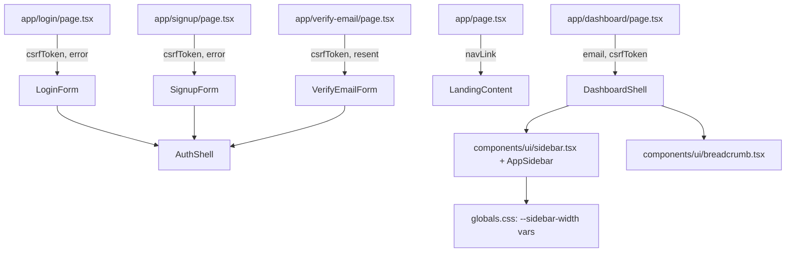

# Frontend shadcn Layouts Design

**Spec**: `.specs/features/frontend-shadcn-layouts/spec.md`
**Context**: `.specs/features/frontend-shadcn-layouts/context.md`
**Status**: Approved

---

## Architecture Overview

Presentation-only refactor. Every `app/*/page.tsx` stays an async Server Component that does exactly what it does today at the request boundary (`headers()`, `cookies()`, `searchParams`, session guard, `redirect`) and then renders a **sync presentational component** with plain props. The presentational components are the unit under test (`react-dom/server` in Vitest); the pages keep no markup of their own beyond the call.



Conformance to active decisions: AD-004 (no `NEXT_PUBLIC_*`, nothing new reaches the browser but markup), AD-005 (no change to `proxy.ts` / `headers.ts`), AD-006 (the sidebar block source was fetched from the registry and inspected — findings below — rather than recalled).

---

## Research Findings (AD-006)

Fetched `https://ui.shadcn.com/r/styles/radix-nova/{sidebar,sheet,tooltip,separator,skeleton,use-mobile,breadcrumb}.json` on 2026-09-12.

- `sidebar` depends on `button`, `separator`, `sheet`, `tooltip`, `input`, `use-mobile`, `skeleton` (all `cn`-based; `button` and `input` already exist in `components/ui/`). The CLI will add `separator.tsx`, `sheet.tsx`, `tooltip.tsx`, `skeleton.tsx`, `hooks/use-mobile.ts`.
- **Only `sidebar.tsx` carries inline `style=` props**, at three sites: `SidebarProvider` wrapper (`--sidebar-width`, `--sidebar-width-icon`), the mobile `SheetContent` (`--sidebar-width: 18rem`), and `SidebarMenuSkeleton` (`--skeleton-width`). `sheet`, `tooltip`, `separator`, `skeleton`, `breadcrumb` have none.
- `useIsMobile` is SSR-safe (`useState(undefined)` + `useEffect`), so the server render always takes the desktop branch — the `Sheet` never appears in SSR HTML.
- `SidebarProvider` writes `document.cookie = "sidebar_state=…"` client-side and registers a `Ctrl/Cmd+B` shortcut; neither touches the server.
- `tsconfig.json` already has `"jsx": "react-jsx"` and `"@/*": ["./*"]`; `vitest.config.mts` only needs its `include` widened to `**/*.test.{ts,tsx}`.

Unverified (to confirm in the first test task, not assumed): whether `next/link` renders as a plain `<a>` under `react-dom/server` outside a Next router context. If it throws, the presentational components take `LinkComponent` as an optional prop defaulting to `Link`, and tests pass `"a"`.

---

## Code Reuse Analysis

### Existing Components to Leverage

| Component | Location | How to Use |
| --- | --- | --- |
| `Button`, `Input`, `Label`, `Alert` | `web/components/ui/*` | Unchanged; used by the new forms. `Card` stays in the tree (still shipped by shadcn) but is no longer imported by any page. |
| `headerNavLink` | `web/lib/nav.ts` | Unchanged; `app/page.tsx` still passes its result into `LandingContent`. |
| `dashboardRedirect`, `getSessionState` | `web/lib/dashboard-guard.ts`, `web/lib/auth/session.ts` | Unchanged; the dashboard page's guard block is copied verbatim above the `DashboardShell` call. |
| Generic message constants | `app/login/page.tsx:16`, `app/signup/page.tsx:16`, `app/verify-email/page.tsx:16` | Move with the JSX into the form components so tests assert the literal strings. |
| CSS variables `--sidebar*` | `web/app/globals.css` (already defined by the shadcn init) | Colors exist; only the two width variables are added. |

### Integration Points

| System | Integration Method |
| --- | --- |
| `proxy.ts` CSP | Consumed, not changed. The design guarantees no `style=` in SSR output so the nonce-only `style-src` holds. |
| `/api/auth/*` Route Handlers | Same forms, same field names, same hidden `csrf_token`. |
| Vitest | `include: ["**/*.test.{ts,tsx}"]`; component tests use `renderToStaticMarkup` from `react-dom/server` (no DOM library added). |

---

## Components

### `AuthShell`

- **Purpose**: The shared, card-less centered column used by the three auth screens (UI-01, UI-02).
- **Location**: `web/components/auth/auth-shell.tsx` (Server Component, no `"use client"`).
- **Interfaces**: `AuthShell({ title, description, footer, children }: { title: string; description: string; footer: React.ReactNode; children: React.ReactNode })` → `<main className="mx-auto flex w-full max-w-sm flex-1 flex-col justify-center gap-6 px-6 py-16">` with `<h1>`/`<p>` header, `children` (alert + form), `footer` paragraph.
- **Dependencies**: none beyond Tailwind classes.
- **Reuses**: the existing `<main>` wrapper classes from `app/login/page.tsx:32`.

### `LoginForm`, `SignupForm`, `VerifyEmailForm`

- **Purpose**: The form bodies, one per screen (UI-03, UI-04, UI-05), each wrapping itself in `AuthShell`.
- **Location**: `web/components/auth/login-form.tsx`, `signup-form.tsx`, `verify-email-form.tsx`.
- **Interfaces**: `LoginForm({ csrfToken, error }: { csrfToken: string; error: boolean })`; `SignupForm({ csrfToken, error })`; `VerifyEmailForm({ csrfToken, resent })`. Each exports its message constant (`LOGIN_GENERIC_ERROR`, etc.) for tests.
- **Dependencies**: `Alert`, `Button`, `Input`, `Label`, `next/link`, `AuthShell`.
- **Reuses**: the exact `<form>` markup from the current pages (only the `Card*` wrappers are dropped; the signup `<ul>` of password rules is deleted).

### `LandingContent`

- **Purpose**: The landing page body without the security feature card (UI-12, UI-13).
- **Location**: `web/components/landing-content.tsx`.
- **Interfaces**: `LandingContent({ navLink }: { navLink: HeaderNavLink })`.
- **Dependencies**: `Button`, `next/link`, `HeaderNavLink` type.
- **Reuses**: header + title + CTA block from `app/page.tsx`; new neutral description (agent's discretion, pt-BR).

### `components/ui/sidebar.tsx` (+ `sheet`, `tooltip`, `separator`, `skeleton`, `breadcrumb`, `hooks/use-mobile.ts`)

- **Purpose**: The shadcn blocks, installed with `npx shadcn@latest add sidebar breadcrumb` from `web/`.
- **Location**: `web/components/ui/*.tsx`, `web/hooks/use-mobile.ts`.
- **CSP adaptation (UI-09, UI-10)** — the only edits to vendored code, each marked with a `// CSP:` comment:
  1. `SidebarProvider`: delete the `style={{ "--sidebar-width": …, "--sidebar-width-icon": …, ...style }}` prop; drop `style` from the destructured props. The two variables move to `globals.css`.
  2. Mobile `SheetContent`: delete the `style={{ "--sidebar-width": SIDEBAR_WIDTH_MOBILE }}` prop; the value moves to `globals.css` under `[data-mobile="true"]`.
  3. `SidebarMenuSkeleton`: delete the `style={{ "--skeleton-width": width }}` prop and the `width` computation; the text skeleton uses a fixed `w-3/5` class. (Component unused; edited so the "no `style=`" invariant holds for the whole file.)
  The `SIDEBAR_WIDTH*` constants are deleted with their last use.
- **`globals.css` additions** (in `@layer base`):
  ```css
  [data-slot="sidebar-wrapper"] { --sidebar-width: 16rem; --sidebar-width-icon: 3rem; }
  [data-slot="sidebar"][data-mobile="true"] { --sidebar-width: 18rem; }
  ```

### `AppSidebar`

- **Purpose**: The project's concrete sidebar (UI-06, UI-08).
- **Location**: `web/components/dashboard/app-sidebar.tsx` (`"use client"` not required — it only composes client primitives and receives strings).
- **Interfaces**: `AppSidebar({ email, csrfToken }: { email: string; csrfToken: string })` → `Sidebar` › `SidebarHeader` (brand "Projeto Aplicado") › `SidebarContent` › `SidebarGroup` › `SidebarMenu` › one `SidebarMenuButton asChild isActive` wrapping `<Link href="/dashboard">` with a `LayoutDashboard` lucide icon and "Painel" › `SidebarFooter` with the e-mail (`text-xs text-muted-foreground`, truncated) and the logout `<form method="post" action="/api/auth/logout">` + hidden `csrf_token` + `<Button type="submit" variant="outline" size="sm">Sair</Button>`.
- **Reuses**: the logout form from `app/dashboard/page.tsx:53-62`.

### `DashboardShell`

- **Purpose**: `SidebarProvider` + `AppSidebar` + `SidebarInset` with header and central message (UI-07).
- **Location**: `web/components/dashboard/dashboard-shell.tsx`.
- **Interfaces**: `DashboardShell({ email, csrfToken })` → `SidebarProvider` › `AppSidebar` + `SidebarInset` › `<header>` (`SidebarTrigger`, `Separator orientation="vertical"`, `Breadcrumb` › `BreadcrumbPage` "Painel") › `<main className="flex flex-1 flex-col items-center justify-center gap-2 p-6">` › `<h1>` "Bem-vindo ao painel" + `<p>` "Você está autenticado como {email}".
- **Dependencies**: `AppSidebar`, sidebar/breadcrumb/separator primitives.

### Pages (thin wrappers)

- `app/login/page.tsx`: `headers()` + `searchParams` → `<LoginForm csrfToken error={Boolean(error)} />`.
- `app/signup/page.tsx`, `app/verify-email/page.tsx`: same shape.
- `app/page.tsx`: `connection()` + `cookies()` + `headerNavLink` → `<LandingContent navLink />`.
- `app/dashboard/page.tsx`: existing guard block untouched → `<DashboardShell email={user.email ?? user.uid} csrfToken />`.
- `app/layout.tsx`: only `metadata.description` changes to a neutral sentence (UI-15).

---

## Data Models

None — props are strings/booleans; no state added.

---

## Error Handling Strategy

| Error Scenario | Handling | User Impact |
| --- | --- | --- |
| `?error` / `?resent` query present | Same as today: boolean prop → `Alert` | Same generic message as before |
| Missing `x-csrf-token` header | Same as today: empty hidden value; route rejects POST | Unchanged |
| JS disabled | All forms are plain HTML `POST`; `SidebarTrigger` becomes inert but the sidebar is expanded by default on `md+` | Fully usable on desktop; mobile sidebar needs JS (P2) |

---

## Risks & Concerns

| Concern | Location (file:line) | Impact | Mitigation |
| --- | --- | --- | --- |
| Nonce-only `style-src` vs. shadcn sidebar inline styles | `web/lib/security/headers.ts:33`; registry `sidebar.tsx` (3 sites) | Sidebar width variables silently unapplied → broken layout, CSP console errors | Strip the three `style=` props, move variables to `globals.css`; test asserts no `style=` in `DashboardShell` SSR output (UI-09) and `headers.test.ts` keeps asserting the CSP (UI-10). |
| No page-level render tests exist today | `web/vitest.config.mts` (`*.test.ts` only) | The removal ACs (UI-12..15) would be unverifiable | Presentational-component split + `react-dom/server` tests; `include` widened to `.tsx`. |
| `next/link` under `react-dom/server` in tests | new `components/auth/*.test.tsx` | Test may throw outside a Next router context | Verify in the first test task; fallback is an injectable link component (see Research). |
| Vendored file drift | `web/components/ui/sidebar.tsx` | A future `shadcn add sidebar --overwrite` would reintroduce `style=` | `// CSP:` comments at each edit + the UI-09 test fails loudly on regression. |
| Sidebar keyboard shortcut / cookie are client JS | `sidebar.tsx` `SidebarProvider` | None for security (cookie is non-httpOnly, unread by server); noted for the reviewer | Keep as shipped (context.md decision). |

---

## Tech Decisions (only non-obvious ones)

| Decision | Choice | Rationale |
| --- | --- | --- |
| Where the sidebar width vars live | `globals.css` attribute selectors, not `style=` | Nonce cannot authorize `style` attributes; relaxing CSP is off the table (spec assumption). |
| Test harness for UI | `react-dom/server` `renderToStaticMarkup`, no jsdom/RTL | Asserting strings/attributes in SSR HTML is exactly what the ACs state; zero new dependencies. |
| Pages vs. presentational components | Pages are wrappers; components own markup | Only way to unit-test copy removal without a Next runtime. |
| Sidebar `collapsible` mode | `"icon"` (block default) | Matches the dashboard example; desktop users can collapse to icons. |
| Landing description wording | "Aplicação web do Projeto Aplicado. Crie uma conta ou entre para acessar o painel." (agent's discretion) | Neutral, keeps "Projeto Aplicado" for APP-01. |
| Metadata description wording | "Aplicação web do Projeto Aplicado." | Satisfies UI-15's forbidden-word list. |

> **Project-level decision to record:** none new. The "no inline `style` attributes under nonce-only CSP" rule is a consequence of the existing header set; it is documented here and enforced by test rather than promoted to an AD.
