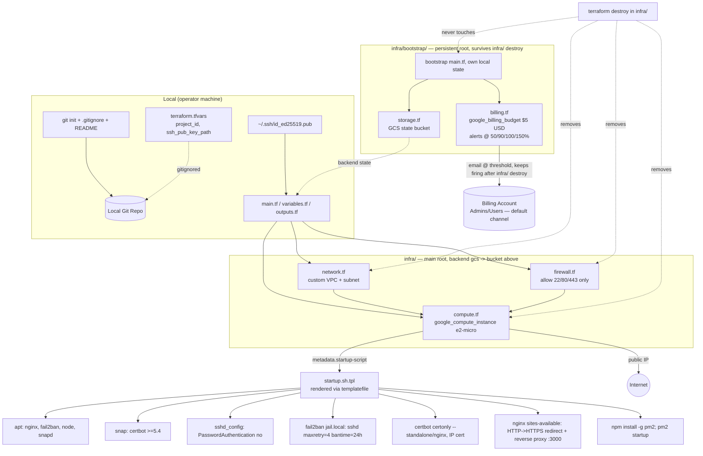

# GCP Infrastructure Provisioning with Terraform — Design

**Spec**: `.specs/features/gcp-infra-terraform/spec.md`
**Status**: Draft

---

## Architecture Overview

Two Terraform roots, deliberately separated by blast radius: `infra/bootstrap/` holds the only two resources meant to *outlive* a teardown — the GCS state bucket and the billing budget, both zero-cost — with its own local state, applied once and rarely touched again. `infra/` (the main root, flat, no reusable modules — one project, no multi-env need) holds everything billable: a dedicated custom VPC (never the GCP `default` network, which ships with permissive `default-allow-*` rules that would silently violate the least-privilege requirement) and one `e2-micro` instance running an idempotent startup script. `infra/` backs its state into the bucket `infra/bootstrap/` created. A single `terraform destroy` in `infra/` tears down every billable resource while `infra/bootstrap/`'s two resources — including the budget, still watching for spend — are structurally unreachable from that command. Git is initialized locally, independent of Terraform, as the outer wrapper around the whole repo.



---

## Architecture Approach (chosen vs alternatives)

**Chosen: Flat root Terraform config + dedicated custom VPC + shell startup script via `templatefile()`.**

| Approach | Trade-off | Verdict |
| --- | --- | --- |
| **A. Flat root, file-per-concern, custom VPC** (chosen) | Simplest to read/grade for a single-environment coursework project; custom VPC removes GCP's permissive default rules entirely instead of fighting them. Slightly more upfront work (defining a VPC/subnet that `default` would've given for free). | **Recommended** — matches actual scope (one env, one grader reading the code), and is the only option that makes "only 22/80/443 exposed" true by construction rather than by remembering to delete defaults. |
| B. Reusable modules (`modules/network`, `modules/compute`) from day one | Cleaner for multi-environment reuse later. | Rejected — premature abstraction; no second environment planned, adds indirection a grader has to trace through. |
| C. Reuse GCP `default` VPC, delete/override `default-allow-*` rules in Terraform | Less code (no VPC/subnet resources). | Rejected — fragile: relies on remembering every default rule (`default-allow-ssh`, `default-allow-internal`, `default-allow-icmp`, `default-allow-rdp`) and correctly negating each; one miss and the least-privilege requirement silently fails. |
| D. Configuration via cloud-init YAML instead of shell startup script | More declarative for package/user config. | Rejected — Certbot's snap install and PM2's `pm2 startup` (which needs to execute the command it prints) are procedural steps that read more naturally as shell; mixing cloud-init modules with raw `runcmd` shell gives no real benefit here. |

---

## Code Reuse Analysis

Greenfield project — no existing Terraform, no existing scripts. Nothing to reuse yet; this feature establishes the patterns future features (CI/CD, app deploy) will build on.

### Integration Points

| System | Integration Method |
| --- | --- |
| GCP project (pre-existing, per spec assumption) | `project_id` Terraform variable, no project-creation resource in this config |
| Operator's local SSH keypair | Public key file read via `file(var.ssh_public_key_path)`, injected into instance `metadata.ssh-keys` — private key never touches Terraform or the repo |
| Let's Encrypt | Certbot's ACME client called from the startup script against the instance's own public IP (no domain, no external DNS integration) |
| Future Next.js deploy (out of scope here) | PM2 `ecosystem.config.js` + Nginx `proxy_pass` are the contract this feature hands off to the app-deploy feature |
| Operator's GCP Billing Account (pre-existing) | `google_billing_account` data source looked up by `billing_account_name`; budget scoped to this project only |

---

## Components

### `network.tf` — Custom VPC + Subnet

- **Purpose**: Dedicated network with no inherited permissive rules, so firewall rules fully define the exposed surface.
- **Location**: `infra/network.tf`
- **Resources**: `google_compute_network` (custom mode, auto-create-subnetworks = false), `google_compute_subnetwork` (single region `us-east1`, e.g. `10.10.0.0/24`).
- **Dependencies**: `project_id`, `region` variables.
- **Reuses**: n/a (greenfield).

### `firewall.tf` — Least-Privilege Ingress Rules

- **Purpose**: Allow exactly TCP 22, 80, 443 from `0.0.0.0/0`; everything else denied by the network's implicit default-deny (custom VPCs have no implicit-allow rules, unlike `default`).
- **Location**: `infra/firewall.tf`
- **Resources**: `google_compute_firewall` × 3 (`allow-ssh`, `allow-http`, `allow-https`), each scoped with a `target_tags = ["web-server"]` so only the tagged instance is affected.
- **Dependencies**: `network.tf`'s VPC self-link.
- **Reuses**: n/a.

### `compute.tf` — e2-micro Instance

- **Purpose**: The VM itself — free-tier machine type, Ubuntu 24.04 image, SSH key metadata, startup script wiring.
- **Location**: `infra/compute.tf`
- **Resources**: `google_compute_instance` (`machine_type = "e2-micro"`, `zone = "us-east1-b"`, `tags = ["web-server"]`, `boot_disk.initialize_params.image = "ubuntu-os-cloud/ubuntu-2404-lts-amd64"`, `boot_disk.initialize_params.type = "pd-standard"`, `boot_disk.initialize_params.size = 30` (GB — pinned to stay within the Always Free 30 GB-month standard-persistent-disk allowance), `network_interface` on the custom subnet with an ephemeral external IP whose `access_config.network_tier = "STANDARD"` (GCP defaults external IPs to `PREMIUM` tier, which is billed differently and is not part of the Always Free egress allowance — `STANDARD` is required to stay inside the free 1 GB/month Compute Engine egress), `metadata = { ssh-keys = "...", startup-script = templatefile(...) }`). External IP `access_config.network_tier = "STANDARD"` (GCP's provider default is `PREMIUM`) — Standard Tier carries its own separate 200 GB/month/region free allowance (Google Cloud, effective Oct 2023), independent of and far larger than the classic Always Free 1 GB Compute Engine egress line item, which is scoped to Premium Tier traffic. No Ops Agent (`google_metadata_endpoints`/`google-cloud-ops-agent`) is installed — Cloud Monitoring/Logging agent data ingestion is billed past a small free allotment and isn't needed for this coursework scope; the startup script logs only to local `journalctl`/syslog. No `google_compute_resource_policy` snapshot schedule is attached to the boot disk, and no separate `google_compute_snapshot`/backup resource is created — the boot disk keeps `auto_delete = true` (default) and nothing schedules recurring snapshots, since snapshot storage is billed independently of the 30 GB-month disk allowance.
- **Interfaces**: `output "instance_external_ip"` — consumed by the operator to test HTTPS/SSH, and by a future CI/CD feature to target deploys.
- **Dependencies**: `network.tf`, `firewall.tf`, `variables.tf` (`ssh_username`, `ssh_public_key_path`).
- **Reuses**: n/a.

### `scripts/startup.sh.tpl` — Idempotent Boot-Time Hardening Script

- **Purpose**: Everything GCP's `startup-script` metadata runs on every boot — package installs, SSH hardening, Fail2ban, Nginx+Certbot, PM2 — written idempotently so re-runs (every reboot) are safe.
- **Location**: `infra/scripts/startup.sh.tpl` (rendered into instance metadata via `templatefile("scripts/startup.sh.tpl", { domain_or_ip = ... })`)
- **Idempotency mechanism**: each stage guards itself — `apt install -y <pkg>` is naturally idempotent; `sshd_config`/`jail.local` edits use a marker comment (`# managed-by-terraform`) checked with `grep -q` before appending; Certbot is invoked with `certbot certificates | grep -q` to skip re-issuance if a valid cert already exists; PM2 install/`pm2 startup` checks `command -v pm2` first.
- **Stages** (in order): (1) `apt update && apt install -y nginx fail2ban snapd nodejs npm`, (2) harden `sshd_config` (`PasswordAuthentication no`, reload sshd), (3) write `/etc/fail2ban/jail.local` with `[sshd] maxretry=4 bantime=24h`, restart fail2ban, (4) `snap install --classic certbot` + symlink (per Certbot's own recommended install path for a current version, since Ubuntu's apt package lags upstream releases), (5) write base Nginx server block (HTTP only, `location /.well-known/acme-challenge/`) so Certbot's webroot validation can complete, (6) run `certbot certonly --webroot --preferred-profile shortlived --ip-address <public-ip>` to obtain the IP certificate — **SPEC_DEVIATION, resolved during Execute (T19), superseding the line originally here**: live sources (EFF blog and Let's Encrypt blog, both dated March 2026) confirm the Nginx/Apache installer plugins do **not** support IP certificates — only `--standalone`/`--webroot`/`--manual` do — and that IP certs require `--preferred-profile shortlived`, meaning a **6-day lifetime**, not an arbitrary CA-controlled one as originally assumed. The script writes its own HTTPS server block manually (`--deploy-hook "systemctl reload nginx"`) instead of relying on a plugin rewrite, (7) confirm/enable Certbot's renewal timer (now load-bearing rather than a nice-to-have, given the 6-day lifetime), (8) `npm install -g pm2`, deploy `ecosystem.config.js` skeleton, `pm2 startup systemd -u <user> --hp /home/<user>` then execute the printed command, (9) write the Nginx `proxy_pass http://localhost:3000` block behind the HTTPS server block from step 6.
- **Dependencies**: Ubuntu 24.04 base image, internet egress (no firewall rule needed — egress is allow-all by default in GCP).
- **Reuses**: n/a.

### `scripts/ecosystem.config.js` — PM2 Process Definition

- **Purpose**: Declares how PM2 runs the Next.js app once deployed (`next start`, port 3000, restart-on-crash).
- **Location**: `infra/scripts/ecosystem.config.js` (copied to `/opt/app/ecosystem.config.js` by the startup script; the app deploy feature later fills `/opt/app` with the actual build).
- **Dependencies**: Node.js + PM2 installed by the startup script.
- **Reuses**: n/a.

### `infra/bootstrap/` — Persistent Root (State Bucket + Billing Budget)

A Terraform root entirely separate from `infra/`, with its own provider block and its own local state (`infra/bootstrap/terraform.tfstate`, itself gitignored). Applied once, early, and normally never destroyed — it exists specifically to hold the two resources that must survive an `infra/` teardown: the GCS state bucket (P3) and the billing budget. Both are zero-cost, so keeping them alive costs nothing and keeps spend monitoring running even with zero billable resources left in the project.

#### `infra/bootstrap/storage.tf` — Remote State Bucket (P3)

- **Purpose**: `google_storage_bucket` that will hold `infra/`'s remote state. **Must be a single-region bucket in `us-east1`** (`location = "us-east1"`, not `"US"` multi-region) — only single-region buckets in `us-east1`/`us-west1`/`us-central1` count against the Always Free 5 GB-months Cloud Storage allowance; a multi-region `"US"` bucket is billed from byte one.
- **Bootstrap sequence**: (1) `terraform apply` inside `infra/bootstrap/` creates the bucket (its own local state, separate from `infra/`'s), (2) operator adds a `backend "gcs" { bucket = "..." }` block to `infra/`, (3) `terraform init -migrate-state` inside `infra/` moves `infra/`'s local state into the bucket. Documented as a README procedure; Terraform cannot self-migrate its own backend inside a single apply, and the two-root split means this bucket is never itself a resource `infra/`'s state could try to destroy.
- **Lifecycle**: no `prevent_destroy` needed here — since the bucket lives in its own root, `infra/` destroy operations can never reach it regardless of lifecycle settings. `prevent_destroy = true` is optionally kept as a second line of defense against an *accidental* `terraform destroy` run directly inside `infra/bootstrap/` itself (a much rarer, more deliberate command).
- **Dependencies**: `project_id`.
- **Reuses**: n/a.

#### `infra/bootstrap/billing.tf` + `billing-data.tf` + `billing-variables.tf` — Budget Alert Safety Net

- **Purpose**: Detect a free-tier drift/leak by email before it becomes a real bill — and keep detecting it even after `infra/` has been fully torn down, since the budget costs nothing to leave running. Pattern and file split taken directly from [eatonc/actual-gcp](https://github.com/eatonc/actual-gcp) (`billing.tf`, `billing-data.tf`, `billing-variables.tf`), a Terraform-for-free-tier-GCP reference repo — adapted here to live in the persistent `infra/bootstrap/` root instead of the main root, specifically so it isn't destroyed alongside the billable resources it's watching over.
- **Resources**:
  - `data "google_billing_account" "billing_account" { display_name = var.billing_account_name }` — looks up the operator's existing billing account by name (no billing account is created by Terraform).
  - `resource "google_project_service" "billingbudgets" { service = "billingbudgets.googleapis.com" }` — API needed before the budget resource can be created.
  - `resource "google_billing_budget" "budget"` — `budget_filter.projects = ["projects/${data.google_project.project.number}"]` (scoped to this project only, not the whole billing account), `amount.specified_amount = { currency_code = var.billing_alert_currency_code, units = var.billing_alert_amount }`, four `threshold_rules` blocks at `0.5`, `0.9`, `1.0`, `1.5`, `depends_on = [google_project_service.billingbudgets]`.
- **Variables**: `billing_account_name` (string, no default — operator must run `gcloud billing accounts list` and supply it, matching the reference repo's approach), `billing_alert_currency_code` (default `"USD"`), `billing_alert_amount` (default `"5"`).
- **Notification**: none explicitly wired — GCP's default behavior emails the budget alert to the billing account's Administrators/Users at each threshold crossing. No Pub/Sub topic, no Cloud Function, no Slack webhook (all out of scope per spec).
- **Dependencies**: an existing GCP billing account already linked to `project_id`.
- **Reuses**: direct structural pattern reuse from `eatonc/actual-gcp`'s three-file split (resource / data / variables).
- **Dependencies**: an existing GCP billing account already linked to `project_id` (spec assumption: project pre-exists).
- **Reuses**: direct structural pattern reuse from `eatonc/actual-gcp`'s three-file split (resource / data / variables), adapted to this project's flat-root layout and variable-naming style.

### Git repo init (non-Terraform)

- **Purpose**: `git init`, `.gitignore`, starter `README.md`, first commit — satisfies GIT-01..04.
- **Location**: repo root.
- **Contents of `.gitignore`**: `.env`, `.env.*`, `*.pem`, `id_rsa*`, `id_ed25519*`, `*.tfstate`, `*.tfstate.backup`, `*.tfvars`, `.terraform/`, `credentials*.json`.
- **`terraform.tfvars.example`** (committed, no real values) documents the variables an operator must fill into their own gitignored `terraform.tfvars`.

---

## Data Models

Not applicable in the app-data sense — this is infrastructure-as-code. The closest equivalent is the Terraform **variable schema**, defined for traceability:

```hcl
variable "project_id"          { type = string }                      # existing GCP project
variable "region"               { type = string, default = "us-east1" }
variable "zone"                 { type = string, default = "us-east1-b" }
variable "ssh_username"         { type = string }                      # e.g. "ubuntu"
variable "ssh_public_key_path"  { type = string }                      # e.g. "~/.ssh/id_ed25519.pub"
variable "state_bucket_name"    { type = string, default = "" }        # P3 only, blank = feature not enabled
variable "billing_account_name" { type = string }                      # e.g. "My Billing Account" — from `gcloud billing accounts list`
variable "billing_alert_currency_code" { type = string, default = "USD" }
variable "billing_alert_amount" { type = string, default = "5" }       # tripwire in whole currency units
```

**Relationships**: `ssh_public_key_path` feeds `compute.tf`'s instance metadata; `state_bucket_name` (if non-empty) feeds `storage.tf`/`backend.tf`.

---

## Error Handling Strategy

| Error Scenario | Handling | User Impact |
| --- | --- | --- |
| `e2-micro` capacity unavailable in `us-east1-b` | Terraform apply fails, no partial instance left (GCP API rejects the create call atomically) | Operator sees GCP's capacity error, re-runs apply or picks another free-tier zone |
| SSH public key file missing at `ssh_public_key_path` | `file()` function fails at plan time | Plan aborts before any resource touches the API — clear "no such file" error |
| Certbot cert issuance fails (API unreachable / rate-limited) | Startup script catches non-zero exit from `certbot`, logs to `journalctl`, leaves the HTTP-only Nginx block from stage 5 active/serving | Site stays reachable over HTTP; operator re-runs the startup script manually (`google_metadata_script_runner startup`) once the issue clears |
| Startup script re-run on reboot | Every stage is guarded (marker checks, `command -v`, `certbot certificates` check) | No duplicate firewall/jail/Nginx entries; idempotent no-op on steps already done |
| PM2 has no app registered yet | `pm2 startup` + empty process list is a valid PM2 state, no error | Nginx `proxy_pass :3000` returns 502 until the app is deployed — expected, not a provisioning failure |
| GCS state bucket exists but `terraform init -migrate-state` run without the `backend "gcs"` block present | Terraform errors immediately ("no backend configured to migrate to") | Operator adds the block first — documented in README's P3 section |
| Operator runs `terraform destroy` expecting it to remove *everything*, including the bucket/budget | Command only ever targets `infra/`'s own state — the two-root split means the bucket/budget are invisible to it (not merely protected, structurally absent from that state) | README explicitly documents the two-command teardown (`terraform destroy` in `infra/`, then optionally again in `infra/bootstrap/`) so this isn't a silent surprise |

---

## Free Tier Validation

Verified against Google's own Always Free documentation (`docs.cloud.google.com/free/docs/free-cloud-features`, fetched during design) — not assumed from training data alone, since GCP terms can change:

| Resource in this design | Always Free limit | Design compliance |
| --- | --- | --- |
| `google_compute_instance` (e2-micro) | 1 non-preemptible e2-micro/month, only in `us-west1`, `us-central1`, `us-east1` | ✅ `us-east1-b` (§ `compute.tf`), exactly one instance, non-preemptible by default |
| Boot disk | 30 GB-months **standard** (`pd-standard`) persistent disk | ✅ pinned to `pd-standard`, `size = 30` in `compute.tf` — a default/unspecified size or `pd-ssd` would silently start billing |
| GCS state bucket (P3, optional) | 5 GB-months **regional** storage, only in `us-east1`/`us-west1`/`us-central1` (multi-region `"US"` does NOT qualify) | ✅ pinned to `location = "us-east1"` single-region in `storage.tf` — Terraform state files are KB-sized, versioning enabled stays far under 5 GB |
| Network egress (Compute Engine) | Two independent free allowances exist: (a) classic Always Free — 1 GB/month from North America, scoped to **Premium Tier**; (b) Standard Tier's own separate free allowance — **200 GB/month per region** (Google Cloud Networking, effective Oct 1 2023) | ✅ pinned `network_tier = "STANDARD"` on the instance's external IP in `compute.tf` — GCP's provider default is `PREMIUM` (only 1 GB free); Standard Tier's 200 GB/month/region allowance is both free and far more headroom for this workload |
| Firewall / VPC / IAM | No Always Free line item — these are zero-cost GCP primitives regardless of tier | ✅ N/A, not a billing concern |
| Ops Agent (Cloud Monitoring/Logging agent) | Not part of Always Free — metrics/log ingestion beyond Cloud Monitoring's small free allotment is billed per GB/per metric | ✅ not installed; startup script relies on local `journalctl`/syslog only, no `google-cloud-ops-agent` package or `google_project_service` enablement for it |
| Disk snapshots / backups | Not part of Always Free — snapshot storage is billed per GB (~$0.026/GB/month) independently of the 30 GB-month standard-disk allowance; automatic snapshot schedules can accumulate cost silently | ✅ no `google_compute_resource_policy` snapshot schedule and no `google_compute_snapshot` resource defined; boot disk keeps default `auto_delete = true` |
| Billing budget itself | `google_billing_budget` has no cost — Cloud Billing Budget API is free to use | ✅ N/A, not a billing concern; because it's free, it lives in `infra/bootstrap/` and is deliberately kept running even after `terraform destroy` on `infra/`, so spend monitoring never lapses |

**Verdict: yes, this design stays within GCP's Always Free tier**, contingent on the pinned settings above (network tier, disk type/size, bucket region/location, no Ops Agent, no snapshots) actually landing in the Terraform code as specified here — these become explicit task-level acceptance checks, not left to defaults.

**Cross-check against practitioner guides:** [dev.to guide](https://dev.to/jeaniscoding/how-to-host-your-side-projects-for-0-the-ultimate-gcp-free-tier-guide-3p07) independently confirms all four non-obvious settings in this design: switch network tier to Standard, use 30 GB Standard persistent disk, disable the Ops Agent (its own stated reason is RAM pressure on a 1 GB `e2-micro`, a secondary win alongside cost), and select "No backups." A second guide (tonyteaches.tech) could not be fetched directly (HTTP 403) — a secondary search-engine snippet of it surfaced a conflicting claim ("leave network tier as Premium"), which is not trusted here since it wasn't independently verifiable and contradicts Google's own Oct-2023 Standard Tier announcement; the design follows the two sources that were actually verifiable (Google's official docs/blog + the dev.to guide).

Sources: [Compute Engine free tier usage limits (docs.cloud.google.com, pt-br)](https://docs.cloud.google.com/free/docs/free-cloud-features?hl=pt-br), [Standard Tier 200 GB/month free data transfer announcement (Google Cloud Blog)](https://cloud.google.com/blog/products/networking/standard-tier-network-now-includes-200-gb-data-transfer-per-month), [GCP free-tier hosting walkthrough — network tier, disk type, Ops Agent, backups](https://dev.to/jeaniscoding/how-to-host-your-side-projects-for-0-the-ultimate-gcp-free-tier-guide-3p07)

---

## Risks & Concerns

| Concern | Location | Impact | Mitigation |
| --- | --- | --- | --- |
| Compute Engine's Always Free network egress is only **1 GB/month from North America** — a public HTTPS site with any real traffic (or repeated SSL Labs test runs) can exceed it | `infra/compute.tf`, whole VM | Exceeding 1 GB starts billing standard egress rates (small, but no longer "free") | Acceptable for coursework-scale traffic (grader + a few test hits); documented in README as a known limit, not something Terraform can cap without also capping legitimate traffic |
| Ubuntu's apt `certbot` package version routinely lags upstream releases, may not satisfy PRD's "Certbot 5.4 or superior" | `infra/scripts/startup.sh.tpl` stage 4 | Wrong/old Certbot could lack IP-certificate support entirely | Install via `snap install --classic certbot` (Certbot's own recommended channel) instead of `apt install certbot`, which tracks upstream releases much faster |
| Let's Encrypt's IP-certificate issuance is a newly-GA'd feature (Jan 2026 per PRD link); exact CLI flags/behavior for a "current" Certbot at the time this is actually run are not verifiable from this codebase or my training data | `infra/scripts/startup.sh.tpl` stage 5-6 | Script's exact `certbot` invocation may need adjusting against live docs when implemented | Flagged as uncertain (Knowledge Verification Chain step 5) — implementation task must re-check `certbot --help` / official docs on the actual VM before finalizing the exact command, rather than trusting a guessed flag set |
| GCP `default` network's implicit rules are easy to forget and silently reintroduce open ports if anyone later adds a resource without `network = google_compute_network.custom.self_link` | `infra/network.tf`, `infra/compute.tf` | A future change could accidentally attach a resource to `default` VPC, bypassing the least-privilege boundary | Compute resource explicitly references the custom VPC/subnet by resource reference (not by name string), so Terraform would error on typos rather than silently falling back to `default` |
| Startup script idempotency is self-guarded (marker comments, `command -v` checks) rather than using a proper config-management tool | `infra/scripts/startup.sh.tpl` | A missed guard on a future edit could duplicate a config block on next reboot | Acceptable for single-VM coursework scope; flagged here so a future maintainer knows this is a deliberate trade-off, not an oversight |
| No monitoring/alerting on Fail2ban bans or Certbot renewal failures | `infra/scripts/startup.sh.tpl` | Silent failures (e.g., renewal breaks) wouldn't page anyone | Out of scope for this feature (PRD doesn't require it); acceptable for coursework, noted for completeness |
| `google_billing_budget` only alerts — it cannot stop resource creation or cap spend | `infra/billing.tf` | A runaway resource (e.g., someone manually resizing the VM in the console) would still accrue cost between the alert email and the operator noticing/acting | Acceptable trade-off: GCP has no native hard spend-cap; auto-shutdown-on-breach would need a Cloud Function + Pub/Sub subscriber, explicitly out of scope per spec's Out of Scope table |
| `billing_account_name` has no default and must be supplied per-operator | `infra/bootstrap/billing-variables.tf` | `terraform apply` fails immediately if the variable is unset or misspelled | By design (AC6) — fails fast with a clear provider error rather than silently defaulting to the wrong billing account |
| Two separate Terraform roots means two separate `terraform init`/`apply` invocations and two separate `.tfstate` files to keep straight | `infra/bootstrap/`, `infra/` | An operator could get confused about which root to run commands in, or accidentally run `terraform destroy` inside `infra/bootstrap/` thinking it's the main root | README documents the exact two-root workflow step-by-step; `infra/bootstrap/`'s optional `prevent_destroy` on the bucket adds a manual confirmation speed bump for that specific mistake |

---

## Tech Decisions

| Decision | Choice | Rationale |
| --- | --- | --- |
| Terraform layout | Flat root, file-per-concern (`network.tf`, `firewall.tf`, `compute.tf`, `storage.tf`, `backend.tf`, `variables.tf`, `outputs.tf`) under `infra/` | Single environment, no reuse target — modules would be premature abstraction (user-confirmed) |
| Network | Dedicated custom VPC + subnet, never GCP `default` | `default` network ships pre-existing permissive firewall rules that would undermine the least-privilege requirement even after adding new rules on top (user-confirmed) |
| Startup config delivery | Shell script template rendered via Terraform's `templatefile()`, not inline HCL string or cloud-init YAML | Certbot/PM2 setup is inherently procedural; keeping it in a real `.sh` file (vs. an inline string) makes it lintable/testable/version-diffable on its own |
| Certbot install method | `snap install --classic certbot` | Apt's certbot package version lags upstream; snap tracks latest releases, needed to plausibly satisfy "Certbot ≥5.4" |
| Next.js process manager | PM2 (`pm2 startup` + `ecosystem.config.js`), not a hand-written systemd unit | Per spec assumption (user-revised): PM2 gives restart/log-rotation/monitoring out of the box; `pm2 startup` still registers a systemd unit under the hood for boot survival |
| Terraform state | Bucket created in a separate `infra/bootstrap/` root (local state), `infra/` then migrates its own local state into that bucket via a documented two-step procedure | A `backend "gcs"` block can't reference a bucket declared in the same state it would back — standard chicken-and-egg. Splitting into two roots (rather than one root + `prevent_destroy`) is what makes a full `terraform destroy` of `infra/` actually work, since `prevent_destroy` would otherwise abort that entire destroy plan |
| Boot disk type/size | `pd-standard`, 30 GB, pinned explicitly (not left to provider default) | Verified against Always Free docs: only standard persistent disk up to 30 GB-months is free; a default disk size or `pd-balanced`/`pd-ssd` would incur cost |
| State bucket location | Single-region `us-east1` (not multi-region `"US"`) | Verified against Always Free docs: only single-region buckets in `us-east1`/`us-west1`/`us-central1` count toward the 5 GB-months free allowance |
| Billing budget amount, thresholds, file split | `$5 USD`, alerts at 50/90/100/150%, split into `billing.tf`/`billing-data.tf`/`billing-variables.tf` | User-requested cost safety net; values and structure lifted directly from [eatonc/actual-gcp](https://github.com/eatonc/actual-gcp), a repo purpose-built for staying inside GCP's free tier via Terraform — no need to reinvent threshold tiering |
| Budget notification | Default GCP email-to-billing-admins, no custom channel | Matches the reference repo; a single-operator project has no additional audience to notify, and Pub/Sub/Cloud-Function wiring for auto-remediation is explicitly out of scope |
| Budget + state bucket location (root) | Both declared in `infra/bootstrap/`, not `infra/` | User asked that the (free) billing alert keep running even across a full project teardown; putting it in the same persistent root as the state bucket means one `terraform destroy` in `infra/` can never remove either, no extra mechanism needed |
| No `prevent_destroy` anywhere in `infra/` | Confirmed absent from every resource in the main root | `prevent_destroy = true` aborts Terraform's *entire* destroy plan, not just that resource — incompatible with the user's "clean full teardown via `terraform destroy`" requirement |
| Network tier | `STANDARD` on the instance's external IP (`access_config.network_tier`) | Provider default is `PREMIUM` (only 1 GB/month free via the classic Always Free line item); Standard Tier carries its own separate, far larger 200 GB/month/region free allowance (Google Cloud Networking, since Oct 2023) — Standard is strictly the safer and more generous choice here |
| Observability agent | None — no Ops Agent (Cloud Monitoring/Logging) installed on the VM | Ops Agent ingestion is billed past a small free allotment and isn't required by the PRD; local `journalctl`/syslog is sufficient for this scope and keeps the VM strictly free-tier |
| Disk backups/snapshots | None — no scheduled snapshot policy, no `google_compute_snapshot` resource | User instruction: keep the VM strictly free-tier; snapshot storage is billed per GB regardless of the 30 GB-month disk allowance, and this coursework VM has no data worth backing up (app is redeployed from git, config is redeployed from Terraform) |
