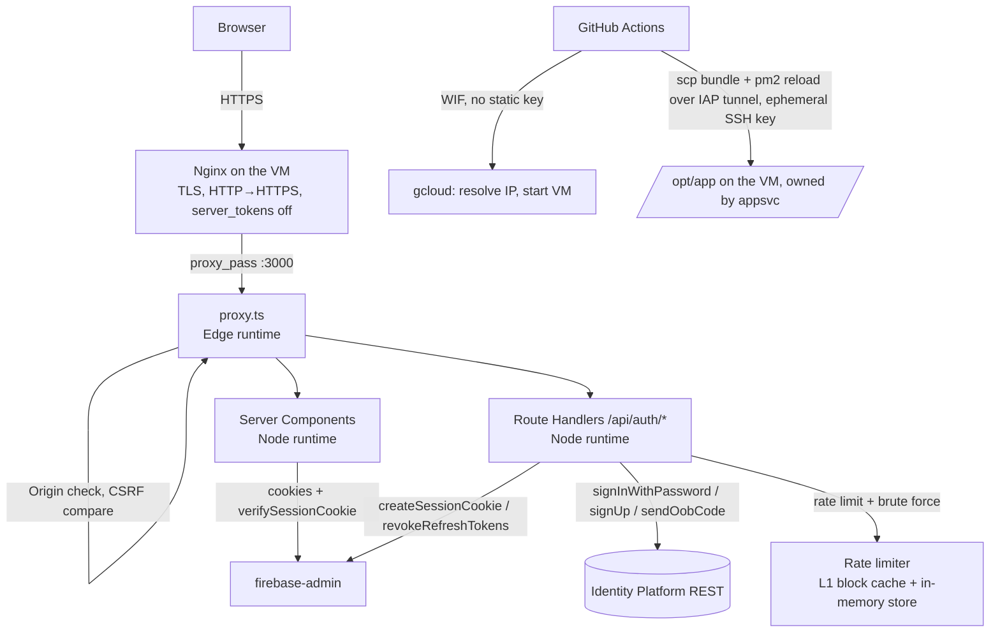

# Next.js Secure Application — Design

**Spec**: `.specs/features/nextjs-secure-app/spec.md`
**Status**: Draft

---

## Architecture Overview

One Next.js 16 app (App Router, TypeScript, SSR-only) living in **`web/`** — a sibling of the existing `infra/`, `ops/`, and `docs/` directories, so each area stays self-contained and `node_modules`/`package.json`/`tsconfig.json` never land at the repository root. It is built in CI and deployed as a `standalone` bundle to `/opt/app` on the existing VM, served by PM2 behind the Nginx reverse proxy that the infra feature already configured.

All application paths below are relative to `web/` (e.g. `web/proxy.ts`, `web/app/page.tsx`, `web/lib/security/headers.ts`).

Every credential stays server-side. The browser receives exactly two cookies — a Firebase **session cookie** and a **CSRF token** — and never sees an API key, a project ID, or the Firebase SDK.



**Why the split matters:** `proxy.ts` runs on the **Edge runtime**, where `firebase-admin` cannot run (it needs Node APIs). So the proxy is limited to what Web Crypto and plain header work can do — headers, Origin checks, CSRF token comparison — and everything requiring the Admin SDK (session verification) plus the rate-limit counters lives in Route Handlers and Server Components, which run on Node. This is a hard runtime boundary, not a preference.

---

## Approach exploration

**Chosen: A — one Next.js app, server-only auth, controls split across the Edge/Node boundary.**

| Approach | Trade-off | Verdict |
| --- | --- | --- |
| **A. Single app; proxy.ts does headers/Origin/CSRF, Route Handlers do auth + rate limiting** (chosen) | One deployable, one process, one PM2 entry — fits a 1 GB e2-micro. Requires being deliberate about which control runs on which runtime. | **Recommended.** Matches the spec's server-only constraint and the VM's resources; the runtime split is a real constraint either way, so making it explicit costs nothing. |
| B. Force `proxy.ts` onto the Node runtime and centralise every control there | All security logic in one file; rate limiting could reject before routing. | Rejected — Node-runtime middleware is a newer, less-exercised path, and running the limiter in front of *every* request (including static asset requests that slip the matcher) adds work to paths that do not need it. |
| C. Next.js frontend + separate auth service (Express/Nest) | Clean separation; auth reusable. | Rejected — two processes on a 1 GB VM, two deploy paths, two attack surfaces, for a prototype with one login form. |
| D. Client-side Firebase SDK + `/api/session` exchange (Google's standard sample) | Least custom code; the documented happy path. | Rejected by an explicit user decision — it publishes the Firebase config in the client bundle, which violates the "no exposed ENVs" requirement. |

---

## Code Reuse Analysis

### What already exists and is reused

| Component | Location | How it's used |
| --- | --- | --- |
| Nginx reverse proxy to `localhost:3000` | `infra/scripts/startup.sh.tpl` (stage 10) | Already points at the port this app will bind. No change needed beyond `server_tokens off`. |
| PM2 + `pm2 startup` boot survival | `infra/scripts/startup.sh.tpl` (stage 9) | The app is registered with the existing PM2 instance; `pm2 save` makes it survive reboots. |
| `infra/scripts/ecosystem.config.js` | Same | Declares `name: nextjs-app`, `cwd: /opt/app`, `script: current/server.js`, `--env-file /opt/app/.env.production`. Rewritten from the repo on every boot AND every deploy (a VM provisioned earlier kept a stale `npm start` copy). |
| Terraform main root + provider config | `infra/*.tf` | New GCP resources (Firebase project, Identity Platform, WIF, Secret Manager) are added here, reusing `user_project_override`/`billing_project` already set. `google-beta` is added to `required_providers` for `google_firebase_project`. |
| VM start/stop with IP reservation | `ops/vm-start.sh`, `ops/vm-stop.sh` | Operator-only. The deploy workflow does **not** reproduce the reservation: when the VM is stopped it just runs `gcloud compute instances start`, waits for `RUNNING`, and reads the new ephemeral IP (CICD-04). The static-IP reservation stays here for the operator's stable-IP-for-a-session need. |
| `.gitignore` secret patterns | `.gitignore` | Extended with `.env*` app-level entries; the existing rules already block `.env`, keys, and tfvars. |
| Free-tier and teardown documentation | `docs/` | New app docs slot in beside them; the OWASP section lands in `README.md` per DOCS-01. |

### Integration points

| System | Integration |
| --- | --- |
| Identity Platform | Server-side REST over HTTPS. The API key is read at runtime from Secret Manager (`identity-platform-api-key`) with the VM's service account — never in the repo, the bundle, a GitHub secret, or `.env.production`. Env var `IDENTITY_PLATFORM_API_KEY` overrides for local dev. |
| Secret Manager | `web/lib/gcp/secret.ts` — one `:access` REST call via `google-auth-library`, ambient credentials, result cached per process |
| Firebase Admin SDK | Route Handlers only (session cookie mint/verify/revoke), using Application Default Credentials from the VM's attached service account |
| Nginx | Sets `X-Forwarded-For`; the app reads its left-most entry for client IP (SEC-06) |
| GitHub Actions | WIF → short-lived GCP token → `gcloud` for IP resolution, VM start, and `compute scp`/`ssh --tunnel-through-iap` for the file transfer and remote commands. gcloud mints an ephemeral IAM-scoped SSH key from the deploy SA identity — no key stored anywhere. Remote file ops run under `sudo` (ephemeral login user in `google-sudoers`) and hand ownership to `appsvc`. |

---

## Components

### `web/proxy.ts` — Edge-runtime security gate

- **Purpose**: The single place every request passes through before routing. Generates the CSP nonce, sets the full OWASP header set, enforces same-origin on `/api/*`, and validates the CSRF token on state-changing requests.
- **Location**: `web/proxy.ts` (beside `web/app/`)
- **Runtime**: Edge. **No `firebase-admin`, no Node-only API here.**
- **Interfaces**:
  - `export function proxy(request: NextRequest): NextResponse`
  - `export const config = { matcher: [...] }` — matches everything except `_next/static`, `_next/image`, and `favicon.ico`; unlike the Next.js sample it **does not** exclude `/api`, because API routes need the Origin and CSRF checks.
- **Behaviour**:
  1. Generate a nonce (`crypto.randomUUID()` → base64), set it on the outgoing request as `x-nonce` and inside the CSP header, exactly as Next.js 16 documents — Next then applies it to framework scripts automatically.
  2. Build and set the header set from `lib/security/headers.ts`.
  3. For `POST|PUT|PATCH|DELETE`: require `Origin` (or `Referer`) to equal the app's own origin → 403 otherwise; require the submitted CSRF token to match the cookie in constant time → 403 otherwise.
- **Note on file naming**: In Next.js 16 this file is `proxy.ts` exporting `proxy()`. The older `middleware.ts`/`middleware()` convention is the pre-16 name — verified against the Next.js 16.3.4 CSP guide.
- **Requirements**: SEC-08..SEC-20, SEC-21..SEC-24

### `lib/security/headers.ts` — the OWASP header set

- **Purpose**: One pure function producing every security header, so the values are unit-testable without booting a server.
- **Interfaces**: `buildSecurityHeaders(opts: { nonce: string; isDev: boolean; sensitive?: boolean }): Record<string, string>`
- **Values** (per the OWASP HTTP Headers Cheat Sheet):
  - `Content-Security-Policy`: `default-src 'self'; script-src 'self' 'nonce-<n>' 'strict-dynamic'; style-src 'self' 'nonce-<n>'; img-src 'self' blob: data:; font-src 'self'; object-src 'none'; base-uri 'self'; form-action 'self'; frame-ancestors 'none'; upgrade-insecure-requests` (dev adds `'unsafe-eval'` for React's debug tooling, production never does)
  - `Strict-Transport-Security: max-age=63072000; includeSubDomains` (no `preload` — an IP host cannot be submitted)
  - `X-Frame-Options: DENY`, `X-Content-Type-Options: nosniff`, `X-XSS-Protection: 0`, `Referrer-Policy: strict-origin-when-cross-origin`, `Permissions-Policy: geolocation=(), camera=(), microphone=()`
  - `Cross-Origin-Opener-Policy: same-origin`, `Cross-Origin-Embedder-Policy: require-corp`, `Cross-Origin-Resource-Policy: same-site`
  - `Cache-Control: no-store` when `sensitive`
  - Never emits `Access-Control-Allow-Origin`, `Expect-CT`, or `Public-Key-Pins`
- **Requirements**: SEC-08..SEC-20

### `lib/security/csrf.ts`

- **Purpose**: Generate and verify CSRF tokens without leaking timing information.
- **Interfaces**: `generateCsrfToken(): string` (32 random bytes, base64url); `verifyCsrfToken(submitted: string | null, cookie: string | null): boolean` (length-check then constant-time compare over the full buffers)
- **Notes**: Uses Web Crypto (`crypto.getRandomValues`, `crypto.subtle`) so the same module works on Edge and Node. Tokens are never derived from the session, the user ID, or a timestamp (SEC-24).
- **Requirements**: SEC-21..SEC-24

### `lib/security/rate-limit.ts` — general limiter and brute-force blocker

- **Purpose**: Per-IP counting with a persistent store and an in-process fast path.
- **Location**: `lib/security/rate-limit.ts`; called from Route Handlers (Node runtime only).
- **Interfaces**:
  - `checkRateLimit(ip: string, bucket: "auth" | "general", now?: number): Promise<{ allowed: boolean; retryAfterSeconds?: number }>`
  - `recordLoginFailure(ip: string, now?: number): Promise<{ blocked: boolean; retryAfterSeconds?: number }>`
  - `resetLoginFailures(ip: string): Promise<void>`
- **Design**:
  - **L1 (memory)**: a `Map<ip, { blockedUntil: number }>`. A request from an IP with `blockedUntil > now` is rejected immediately, with **no store read or write** (SEC-07) — this is what stops a sustained attack from consuming a backing store's daily quota.
  - **L2 (`createInMemoryStore`)**: a process-local `Map` keyed by IP (`rate_limits/{ip}`). Its `transact` does a synchronous read-modify-write, which on single-threaded Node cannot interleave and skip the 5th-failure threshold. `RateLimitStore` stays an interface so a test can inject a throwing fake; there is no other implementation (AD-009). Counters reset on process restart.
  - Thresholds are injected, not hardcoded at call sites: 5 failures → 60s block; `auth` bucket 10 req/min; `general` bucket 100 req/min.
  - `now` is an injectable parameter so tests can drive the clock deterministically instead of sleeping.
- **Failure mode**: if the store throws during a **login** attempt, `checkRateLimit` propagates and the route returns 503 — failing **closed**, per the spec's edge case. The general limiter fails open (a 100 req/min cap is not a security guarantee worth taking the site down for). The in-memory store cannot actually throw; the branch is kept and unit-tested with an injected throwing fake so the contract survives if a network-backed store is ever added.
- **Requirements**: SEC-01..SEC-07, SEC-25..SEC-27

### `lib/auth/identity-platform.ts` — server-side REST client

- **Purpose**: The only module that talks to Identity Platform. Resolves the API key in one place (`IDENTITY_PLATFORM_API_KEY` env var → else Secret Manager `identity-platform-api-key` via `lib/gcp/secret.ts`, keyed by `GOOGLE_CLOUD_PROJECT`; cached per process, failures → `unavailable`) and normalises upstream errors into safe, generic results.
- **Interfaces**:
  - `signUp(email, password): Promise<{ idToken: string; localId: string }>`
  - `signInWithPassword(email, password): Promise<{ idToken: string; localId: string }>`
  - `sendVerificationEmail(idToken): Promise<void>`
- **Endpoints** (verified against Google's Identity Platform REST reference):
  - `POST https://identitytoolkit.googleapis.com/v1/accounts:signUp?key=<API_KEY>`
  - `POST https://identitytoolkit.googleapis.com/v1/accounts:signInWithPassword?key=<API_KEY>` — body `{ email, password, returnSecureToken: true }`
  - `POST https://identitytoolkit.googleapis.com/v1/accounts:sendOobCode?key=<API_KEY>` — body `{ requestType: "VERIFY_EMAIL", idToken }`; Google sends the email itself, so no SMTP is needed
- **Error mapping**: every upstream 400 (`EMAIL_NOT_FOUND`, `INVALID_PASSWORD`, `INVALID_LOGIN_CREDENTIALS`, `EMAIL_EXISTS`) collapses to one generic caller-facing result, so the response cannot be used to enumerate accounts (AUTH-04, AUTH-10). Upstream 5xx maps to a distinct "unavailable" result → HTTP 503.

### `lib/auth/session.ts` — Admin SDK session cookies

- **Purpose**: Mint, verify, and revoke sessions.
- **Interfaces**:
  - `createSession(idToken: string): Promise<string>` — `admin.auth().createSessionCookie(idToken, { expiresIn: 12h })`
  - `verifySession(cookie: string): Promise<DecodedIdToken | null>` — `verifySessionCookie(cookie, true)` (`checkRevoked: true`, AUTH-14)
  - `revokeSession(uid: string): Promise<void>` — `revokeRefreshTokens(uid)`
  - `sessionCookieOptions()` — `{ httpOnly: true, secure: true, sameSite: "strict", path: "/", maxAge: 43200 }`
- **Admin SDK credentials**: Application Default Credentials from the VM's attached service account — no key file on disk.
- **`getAuthenticatedUser(cookieValue: string | null): Promise<AuthUser | null>`**: the guard the `/dashboard` page calls. Returns the user only when the session cookie verifies *and* `email_verified` is true; returns `null` otherwise. Keeping this as a pure-ish function (Admin SDK injected) means the dashboard's redirect rule (AUTH-14, AUTH-16, AUTH-17) is unit-testable, and the page itself stays a thin shell around it.

### `lib/validation/credentials.ts`

- **Purpose**: Pure input validation, unit-tested without any I/O.
- **Interfaces**: `normalizeEmail(raw: string): string | null` (trim, lowercase, RFC shape, ≤254 chars); `validatePassword(pw: string): { ok: true } | { ok: false; failed: PasswordRule }` (≥12 chars, lower, upper, digit, symbol)
- **Requirements**: AUTH-02, AUTH-05

### Route Handlers — `app/api/auth/*`

| Route | Method | Behaviour |
| --- | --- | --- |
| `/api/auth/signup` | POST | rate limit → validate → `signUp` → `sendVerificationEmail` → 303 `/verify-email`; generic 400 on any rejection (AUTH-01..05) |
| `/api/auth/login` | POST | brute-force check → rate limit → `signInWithPassword` → reject unverified (303 `/verify-email`) → `createSession` → `Set-Cookie` → 303 `/dashboard`; failure increments the counter (AUTH-07..12, SEC-01..07) |
| `/api/auth/logout` | POST | `revokeSession` → clear cookie (`Max-Age=0`) → 303 `/` (AUTH-15, AUTH-17) |
| `/api/auth/resend-verification` | POST | rate-limited resend of the verification email |

All four run on the Node runtime, set `Cache-Control: no-store`, and are reached only through `proxy.ts`'s Origin + CSRF gate.

### Pages — `app/`

| Route | Type | Notes |
| --- | --- | --- |
| `/` | Server Component | Public landing; `await connection()` to force dynamic rendering so the nonce applies (APP-01, APP-02) |
| `/login` | Server Component + shadcn form | Posts to `/api/auth/login` with the CSRF hidden field |
| `/signup` | Server Component + shadcn form | Posts to `/api/auth/signup` |
| `/verify-email` | Server Component | Explains the pending verification; offers resend |
| `/dashboard` | Server Component | Reads the session cookie, calls `verifySession`, redirects to `/login` when invalid; shows the user's email and the logout button (AUTH-13..17) |

Route protection is **not** delegated to `proxy.ts` — the Admin SDK cannot run there. The dashboard verifies the session itself on every request, which is also what AUTH-16 requires.

### `ecosystem.config.js` and the deployed layout

```
/opt/app/
├── current -> releases/<sha>     # symlink flipped atomically on deploy
├── releases/<sha>/               # webpack standalone bundle: server.js, .next/, node_modules/, public/
├── .env.production               # chmod 600 — NODE_ENV / PORT / GOOGLE_CLOUD_PROJECT only, no secret
└── ecosystem.config.js           # rewritten from the repo on every boot AND every deploy
```

PM2 runs `node current/server.js` as the `appsvc` user with `PORT=3000`, `NODE_ENV=production`, and `--env-file` pointed at `.env.production`. `/opt/app` and every `releases/<sha>` are owned by `appsvc`; the deploy writes them with `sudo install -o appsvc`. The Identity Platform API key is **not** in `.env.production` — the app reads it from Secret Manager (`identity-platform-api-key`) with the VM's service account, via `web/lib/gcp/secret.ts`.

### GitHub Actions workflows

| Workflow | Trigger | Steps |
| --- | --- | --- |
| `.github/workflows/ci.yml` | `pull_request` → `main` | checkout → setup-node 24 → `npm ci` → `npm run lint` → `npm run typecheck` → `npm test` (TEST-02, TEST-03) |
| `.github/workflows/release.yml` | `push` → `main` | `release-please` maintains the release PR; on a PR merge that cuts a release (`releases_created == true`) it calls `deploy.yml` (CICD-09, AD-008) |
| `.github/workflows/deploy.yml` | `workflow_call` from `release.yml` (+ `workflow_dispatch` for a manual redeploy) — **not** on every push to `main` | `npm ci` → test → `next build` → `google-github-actions/auth` (WIF) → resolve IP / start VM if `TERMINATED` → `gcloud compute scp --tunnel-through-iap` bundle + `ecosystem.config.js` → write non-secret `.env.production` over the tunnel (`install -m 600 -o appsvc`) → `pm2 delete` + `pm2 start` as `appsvc` → poll `https://<ip>/` for 200, 2-minute timeout (CICD-01..08) |

**Secrets consumed** (all from GitHub Actions secrets, never the repo): `GCP_PROJECT_ID`, `GCP_ZONE`, `GCP_WIF_PROVIDER`, `GCP_DEPLOY_SA_EMAIL`. No `IDENTITY_PLATFORM_API_KEY` secret — the running app reads that key from Secret Manager with the VM's service account. `GCP_REGION` is not consumed either. No SSH key or SSH-user secret — VM access is entirely through the WIF-federated deploy SA over an IAP tunnel.

### Terraform additions — `infra/app.tf`, `infra/firebase.tf`, `infra/secrets.tf`, `infra/compute.tf`, `infra/wif.tf`

| Resource | Purpose |
| --- | --- |
| `google_project_service` | `identitytoolkit`, `firebase`, `iam`, `iamcredentials`, `sts`, `iap`, `apikeys`, `secretmanager` — no `firestore` (TF-01) |
| `google_firebase_project` (google-beta) | Marks the project as Firebase-enabled (TF-02) |
| `google_identity_platform_config` | `sign_in.email.enabled = true`, `password_required = true` (TF-02) |
| `google_apikeys_key` + `google_secret_manager_secret` / `..._version` / `..._iam_member` (`infra/secrets.tf`) | The Identity Platform key, restricted to `identitytoolkit.googleapis.com`, mirrored into secret `identity-platform-api-key`; VM SA gets `roles/secretmanager.secretAccessor` on that secret only. App reads it at runtime — no GitHub secret, no `.env.production` line (TF-06) |
| `service_account` block on `google_compute_instance.vm` (`infra/compute.tf`) | Attaches the default compute SA explicitly with `cloud-platform` scope, so the metadata server can mint tokens for firebase-admin ADC and the Secret Manager read |
| `google_iam_workload_identity_pool` + `..._provider` | GitHub OIDC (`issuer_uri = "https://token.actions.githubusercontent.com"`), `attribute_mapping` for `google.subject`/`attribute.repository`/`attribute.repository_owner`, and an `attribute_condition` restricting to this repository (TF-04) |
| `google_service_account` + `google_service_account_iam_member` / `google_compute_instance_iam_member` / `google_iap_tunnel_instance_iam_member` / `google_project_iam_custom_role` + `google_project_iam_member` | Deploy SA bound with `roles/iam.workloadIdentityUser` to the `principalSet://` for this repo; `roles/compute.instanceAdmin.v1` and `roles/iap.tunnelResourceAccessor` scoped to `google_compute_instance.vm` only; `roles/iam.serviceAccountUser` scoped to the VM's attached (default compute) service account only; one minimal custom project role `deployVmOperator` (compute read/list + operation-get only). No predefined project role, never `roles/owner`/`roles/editor` (TF-05) |
| `google_compute_firewall` `allow-iap-ssh` (in `infra/firewall.tf`, alongside the existing rules) + `iap.googleapis.com` service | `tcp:22` from the IAP range `35.235.240.0/20` to `web-server`-tagged instances — the ingress path for the keyless deploy. Additive: `allow-ssh` still opens `:22` to `var.operator_ssh_cidrs` (default `0.0.0.0/0`, for the evaluation board; key-only + Fail2Ban regardless). |
| `outputs.tf` additions | WIF provider resource name, deploy SA email (TF-06) |

---

## Data Models

### Rate-limit state — `rate_limits/{ip}` (a value in the in-memory `Map`)

```ts
type RateLimitState = {
  loginFailures: number       // consecutive failed logins; reset to 0 on success
  blockedUntil: number | null // epoch ms; null when not blocked
  authWindowStart: number     // epoch ms, start of the current 1-minute auth bucket
  authCount: number
  generalWindowStart: number
  generalCount: number
}
```

One `Map` entry per IP (key = left-most `X-Forwarded-For` entry), read-modified-written synchronously. The whole map lives in the Node process and is discarded on restart.

### Session cookie payload

Not a model we define — it is Firebase's session cookie, carrying the same claims as the ID token (`uid`, `email`, `email_verified`, `exp`). The app reads `uid`, `email`, and `email_verified` and stores nothing else about the user.

---

## Error Handling Strategy

| Scenario | Handling | User sees |
| --- | --- | --- |
| Wrong password / unknown email | Collapse both to one result; increment the IP's failure counter | 401 "E-mail ou senha inválidos" — byte-identical either way |
| Email already registered on signup | Same generic rejection as any other signup failure | 400 "Não foi possível criar a conta com esses dados" |
| 5th consecutive failure from an IP | Block for 60s; further attempts short-circuit in the L1 cache | 429 with `Retry-After: 60` |
| Rate-limit store throws during login (network-backed store only) | Fail **closed** — the brute-force guarantee outranks login availability | 503, generic message |
| Rate-limit store throws for the general limiter | Fail open, log it | Normal response |
| Identity Platform 5xx / API key missing | Distinguish from a credential error; log the upstream detail server-side only | 503, generic message |
| Session cookie expired, revoked, or user disabled | `verifySessionCookie(..., checkRevoked: true)` returns null | 303 to `/login` |
| CSRF token missing or mismatched | Rejected in `proxy.ts` before any handler runs | 403 |
| Cross-origin request to `/api/*` | Rejected in `proxy.ts`; no CORS headers emitted at all | 403 |
| Deploy health poll never returns 200 | Workflow fails after 2 minutes so a broken release is visible | Red check on the merge commit |

---

## Risks & Concerns

| Concern | Location | Impact | Mitigation |
| --- | --- | --- | --- |
| `proxy.ts` runs on the Edge runtime — `firebase-admin` cannot run there | `proxy.ts` | Putting session verification in the proxy would fail at runtime, possibly only in production | Hard boundary documented above: proxy does headers/Origin/CSRF only; everything Admin-SDK-backed lives in Route Handlers and Server Components |
| Node 18 on the VM vs `next@16` requiring ≥20.9 | `infra/scripts/startup.sh.tpl` | The deployed bundle would refuse to start | Its own spec story (VM-01..02): install Node 24 LTS from NodeSource, verified by `node --version` on a fresh boot |
| The `principalSet://` member format for the WIF binding is intricate and easy to get subtly wrong | `infra/app.tf` | A wrong member silently grants nothing (deploy fails to authenticate) or too much | The design specifies the `attribute.repository/OWNER/REPO` form, but the implementing task must confirm it against the current provider docs before applying — the same "verify, don't guess" discipline that caught the Certbot plugin issue in the infra feature |
| CSP with a nonce forces every page dynamic — no static optimisation, no PPR | whole app | Slower first byte, more CPU per request on a shared-core e2-micro | Accepted: SSR is an explicit requirement, and traffic is a grader plus a few test hits. Documented so it isn't mistaken for a misconfiguration |
| `COEP: require-corp` breaks any cross-origin subresource that doesn't opt in | `lib/security/headers.ts` | A future third-party script or CDN font would silently fail to load | Safe today (shadcn is local source, `next/font` self-hosts). Flagged in the spec's assumptions so the trade-off is visible before someone adds a CDN |
| `X-Forwarded-For` is client-controllable in principle | `lib/security/rate-limit.ts` | A spoofed header could let an attacker rotate "IPs" and dodge the block | Nginx is the only ingress and overwrites the header for direct traffic; documented as a known limitation rather than claimed as airtight |
| In-memory store resets on every deploy/restart | `lib/security/rate-limit.ts` | Every counter (not just the L1 fast path) is forgotten on restart, so a block does not survive a deploy | Accepted (AD-009): single VM instance, 60s block windows, restarts are rare and operator-driven. A restart mid-attack costs one extra failed attempt per IP before the block re-forms. No durable store, no database dependency |
| Ephemeral SSH key / sshd propagation lag on a just-started VM | `.github/workflows/deploy.yml` | The first `gcloud compute ssh --tunnel-through-iap` after a VM start can fail for ~30-60s while the key reaches instance metadata and the guest agent applies it | The deploy's first remote call retries in a `for i in $(seq 1 12); do ... sleep 5; done` loop before the bundle transfer |
| Verification email deliverability is Google's default sender | Identity Platform | Mail may land in spam, blocking signup end-to-end | Out of our control without a custom SMTP domain (explicitly out of scope); `/verify-email` offers a resend, and the operator can flip `emailVerified` in the console if a demo is blocked |

---

## Tech Decisions

| Decision | Choice | Rationale |
| --- | --- | --- |
| Security-gate file | `proxy.ts` exporting `proxy()`, not `middleware.ts` | Next.js 16 renamed the convention; verified against the 16.3.4 CSP guide rather than assumed from older tutorials |
| Where session verification happens | In Server Components / Route Handlers, never in `proxy.ts` | Edge runtime cannot load `firebase-admin`; a fast cookie-presence check in the proxy would be a convenience, not the authority |
| CSP strategy | Per-request nonce with `'strict-dynamic'`, forcing dynamic rendering | The spec forbids `'unsafe-inline'`; nonce is the approach Next.js documents, and SSR is required anyway so the cost is already paid |
| Rate-limit store | Process-local in-memory `Map` + in-process L1 block cache (AD-009) | User chose the in-memory store; Firestore removed entirely (resource, API, adapter) to cut dependencies. Single VM instance, 60s blocks — durability across restarts is not worth a database |
| Firebase Auth provisioning | `google_firebase_project` (google-beta) + `google_identity_platform_config` | User chose a full Firebase project, not just the Identity Platform config. `google-beta` is added to `required_providers` for this one resource; every other resource stays on the GA `google` provider |
| Identity Platform API key delivery | Secret Manager, read at runtime by the VM's service account (`roles/secretmanager.secretAccessor` on the one secret) | User asked for the key out of `.env` and out of GitHub secrets. One secret, one narrowly-scoped grant; rotation is a new secret version the app picks up on its next cold read. REST `:access` via `google-auth-library` (already in the tree) instead of the full client library |
| VM service account | Default compute SA, attached explicitly with `cloud-platform` scope | It had no attached identity before — which also broke firebase-admin ADC. A dedicated minimal SA is cleaner but expands the WIF/`serviceAccountUser` wiring; out of scope for coursework |
| Login failure mode when the store is down | Fail closed (503) | A login form that stays up without brute-force protection is worse than one that is briefly unavailable |
| Error message policy | One generic message for every credential failure, and for every signup rejection | Prevents account enumeration (OWASP Identification and Authentication Failures) |
| Build location | GitHub Actions, deploying a `standalone` bundle | 1 GB RAM on the VM makes on-host builds slow and OOM-prone |
| Bundler | `next build --webpack` (Turbopack stays for `next dev`) | Next 16's Turbopack build + `output: standalone` emits external packages (`firebase-admin`, `google-auth-library`) with a content-hashed specifier its runtime can't resolve → `ERR_MODULE_NOT_FOUND` on the first Admin-SDK / Secret-Manager call. The webpack build also runs the generated route-type check, so each auth route's `handleX(request, deps)` seam moved to a sibling `handler.ts` and `route.ts` re-exports only `POST`/`runtime` |
| Release layout | `releases/<sha>` + `current` symlink | Atomic flip, trivial rollback, no window where the served directory is half-written |
| CI → GCP auth | Workload Identity Federation with a repository-scoped `attribute_condition` | No long-lived key in GitHub; without the condition any repo could assume the SA |
| CI → VM auth | `gcloud compute ssh`/`scp --tunnel-through-iap`; gcloud mints an ephemeral, IAM-scoped SSH key from the WIF-federated deploy SA identity | No stored SSH key or SSH-user secret. No OS Login toggle needed — the guest agent lands ephemeral keys in `google-sudoers`. IAP tunnel means no need to widen public `:22` |
| App runtime user on the VM | Dedicated locked `appsvc` (hardcoded constant), owns `/opt/app`, runs PM2 | CI connects as its own ephemeral IAP login user, not a fixed operator; decoupling the runtime user from any human keeps the deploy identity-agnostic |
| Deploy SA permissions | `roles/compute.instanceAdmin.v1` + `roles/iap.tunnelResourceAccessor` scoped to the app VM instance; `roles/iam.serviceAccountUser` scoped to the VM's attached service account; one minimal custom project role `deployVmOperator` (`compute.projects.get`, `compute.instances.list`, `compute.zoneOperations.get`, `compute.globalOperations.get`) | Least privilege — start the VM, publish the ephemeral SSH key to metadata, open the IAP tunnel; instance/SA-scoped, plus the project-scoped reads/operation-polling `gcloud ... --tunnel-through-iap` requires that an instance binding cannot carry. No predefined project role, never `roles/owner`/`roles/editor` |
| Test runner | Vitest | Native TypeScript/ESM, fast, and the modules under test are pure functions with injected clocks — no framework bootstrapping needed |
| Clock handling in tests | `now` injected as a parameter | Deterministic assertions at the 5th failure and the 60-second boundary, with no `sleep` in the suite |

> **Project-level decisions** from this design are recorded in `.specs/STATE.md` as `AD-001`..`AD-005`.
